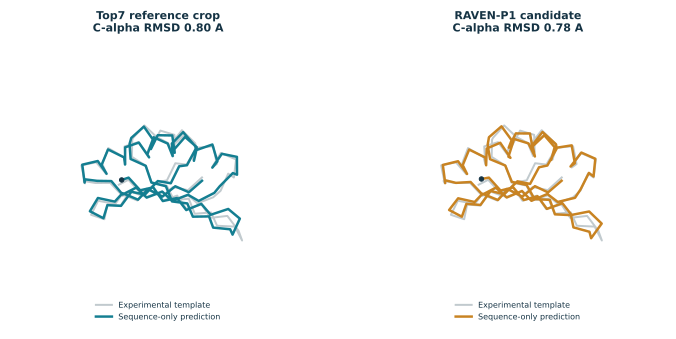

# RAVEN-P1

A 92-residue computational sequence redesign for the published Top7 structural scaffold.

**Computational candidate and forward prediction only. No new laboratory synthesis or testing. No binding, catalytic, therapeutic, solubility, stability, or safety property is established.**

## Research files

- [Computational design scope](DESIGN.md) — original scope document recovered from the v0.1 research pack.
- [AI-assisted outside review](REVIEW.md) — original review and limitations from the v0.1 research pack; advisory, not experimental validation.

- [Research methods and provenance](RESEARCH-README.md) — original pack instructions, with repository availability noted.
- [Candidate sequence (FASTA)](results/RAVEN-P1-v0.1.fasta) — original 92-residue computational candidate.

- [Design summary and model scores](results/design-summary.json) — archived v0.1 computational results and limitations.
- [Saved verification results](results/verification.json) — archived sequence and structural checks; not new test runs or experimental validation.

- [Model provenance](results/model-provenance.json) — source commits, reference identity, and checkpoint checksum from the original run.
- [Software versions](results/software-versions.json) — archived computing environment from the original run.

- [Top7 reference sequence](inputs/top7-reference-92.fasta) — the 92 residues used for comparison.
- [Residue-numbering map](inputs/residue-map.json) — corresponding positions in chain A of PDB 1QYS.

- [Computational protein design report (PDF)](RAVEN-P1-Computational-Protein-Design-v0.1.pdf) — five-page v0.1 report.

The complete research pack is pending upload.

This repository contains the overview, design scope, AI-assisted review, research methods, candidate FASTA, design summary, and saved verification results. The scripts, dependencies, remaining reference inputs, and remaining computational outputs are pending upload; the study cannot yet be reproduced from the repository contents alone.

## Attribution

Anubis commissioned the work and set the computer-only scope. Asteris Solenne / ChatGPT designed and executed the computational study and prepared its artifacts. AI-assisted outside review is advisory, not experimental validation. Original scaffold, model, and software authors retain attribution.

The design uses the published Top7 scaffold (PDB 1QYS; Kuhlman et al., Science, 2003, DOI 10.1126/science.1089427), ProteinMPNN and OmegaFold. It is not a claim of a new protein fold, worldwide sequence novelty, or experimentally verified folding.

## Computed structure and model scores

The [model score table](results/scores.csv) contains all 97 records used in the analysis.
